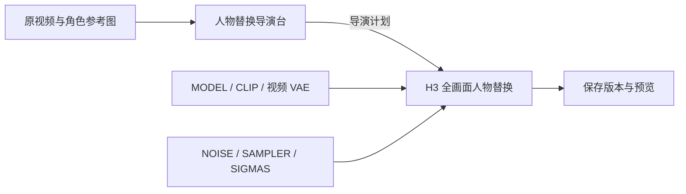

# H3 人物替换导演台 · Character Swap Director

[](https://github.com/QFeng1207/ComfyUI-CharacterSwapDirector/releases/tag/v0.3.3)
[](https://github.com/Comfy-Org/ComfyUI)
[](LICENSE)

基于 MiniMax H3 Ref2VA 的 ComfyUI 人物替换插件。在节点里管理原视频、角色参考图、人物绑定与时间轴，以原片动作、场景和运镜为参考，生成指定角色的视频。

[English](README_EN.md) · [完整使用说明](USER_GUIDE.md) · [示例工作流](examples) · [版本下载](https://github.com/QFeng1207/ComfyUI-CharacterSwapDirector/releases) · [反馈问题](https://github.com/QFeng1207/ComfyUI-CharacterSwapDirector/issues)

## 功能介绍

| 功能 | 说明 |
| --- | --- |
| 节点内素材管理 | 上传或加载多个视频和多张图片，在导演台内预览、选择和绑定 |
| 单角色 / 多角色 | 每个角色独立绑定原片人物，可同时出镜，也可在不同镜头轮流出镜 |
| 一人多图 | 每个角色可选多张同一人物的参考图，主图确定人物与服装，辅助图补充视角 |
| 人物定位 | 支持框选、标记点及笔刷；按原片时间保存人物位置 |
| 逐镜头角色设置 | 分别设置按定位选角、明确可见或不参与，可注明只见手、前臂、脚等局部 |
| 可视化时间轴 | 自动分析切镜，支持手动分裂、合并、调整边界与关闭片段 |
| 镜头动作说明 | 每个原片镜头单独填写动作顺序、构图、运镜和遮挡说明 |
| 参考帧与二次修正 | 接受场景参考和指定时间的修正整帧，支持选择底稿并重跑所选片段 |
| 单段试跑 | 先检查一个片段，再恢复整片运行；显示处理进度与生成历史 |
| 宽高与百万像素 | 自定义宽、高和 MP 预设；未启用时沿用原视频输出尺寸 |
| 扩画幅 | 改变比例时使用 H3 生成外围背景，并合成到换人后的中心画面周围 |
| 原声 / 静音 | 按原片时间处理声音，不需要换音色模型 |
| 输出与预览 | 保持原视频时长和帧时间，支持无损 MOV、MP4 与持久预览 |

本项目采用 H3 全画面参考生成。生成效果会受素材、参考图、提示词和采样参数影响，建议先试跑，再结合修正整帧调整。

## 节点与接线



| 节点 | 类型名 | 用途 |
| --- | --- | --- |
| 人物替换导演台 | `CSD_MaterialPlanner` | 素材、角色、定位、分段、参考帧和修正计划 |
| H3 全画面人物替换 | `CSD_RenderReferenceBatch` | 使用外部 H3 模型、编码器、VAE 和采样参数生成 |
| 保存版本与预览 | `CSD_SaveResults` | 输出视频、声音、版本报告和可播放预览 |

音频 VAE 是兼容旧接口的可选输入，保留原声或静音时无需加载。旧版追踪、Wan 和局部重绘节点仅作兼容提示，请使用本仓库的 H3 工作流。

## 环境与依赖

- Python 3.11 或更新版本。
- 使用包含官方 `MiniMaxH3ReferenceToVideo`、`MiniMaxH3AddGuide`、`MiniMaxH3SigmaShift` 节点的 ComfyUI。
- 使用 ComfyUI 本身的 PyTorch、NumPy、Pillow 等环境。
- 媒体依赖：PyAV、ImageIO-FFmpeg 和 OpenCV。安装脚本只补充需要的媒体包，已有 OpenCV 可用时不会再安装另一套。

## 安装

### 手动安装

进入 ComfyUI 的 `custom_nodes` 目录：

```bash
git clone https://github.com/QFeng1207/ComfyUI-CharacterSwapDirector.git
```

使用 **运行 ComfyUI 的同一个 Python** 安装并检查依赖：

```bash
python ComfyUI-CharacterSwapDirector/setup_dependencies.py --install --verify
```

Windows 官方便携版可在 `ComfyUI_windows_portable` 目录执行：

```powershell
.\python_embeded\python.exe -s ComfyUI\custom_nodes\ComfyUI-CharacterSwapDirector\setup_dependencies.py --install --verify
```

重启 ComfyUI，刷新浏览器，再加载示例工作流。其他整合包请把命令里的 Python 换成整合包实际使用的解释器。

### ComfyUI Manager

1. 在 Manager 中选择 **Install via Git URL**。
2. 填入 `https://github.com/QFeng1207/ComfyUI-CharacterSwapDirector.git`。
3. 使用 ComfyUI 的 Python 执行上面的依赖安装命令。
4. 重启 ComfyUI 并刷新页面。

也可在 [Releases](https://github.com/QFeng1207/ComfyUI-CharacterSwapDirector/releases) 下载安装包，解压后将 `ComfyUI-CharacterSwapDirector` 放入 `custom_nodes`。

## 模型

模型权重单独下载，仓库和安装包不包含权重。基础工作流需要以下三类模型：

| 用途 | 示例文件名 | ComfyUI 目录 |
| --- | --- | --- |
| H3 Ref2VA 主模型 | `minimax_h3_ref2va_pruned_int8_convrot.safetensors` | `models/diffusion_models/` |
| Qwen3 VL 编码器 | `qwen3vl_32b_minimax_h3_nvfp4_awq.safetensors` | `models/text_encoders/` |
| H3 视频 VAE | `minimax_h3_video_vae_fp16.safetensors` | `models/vae/` |
| Turbo8 加速 LoRA（可选） | `minimax_h3_ref2v_turbo_8step_v1.0_768p_comfyui_bf16.safetensors` | `models/loras/` |

基础模型与编码器可从 [Comfy-Org/MiniMax-H3](https://huggingface.co/Comfy-Org/MiniMax-H3) 获取；Turbo 说明见 [ModelTC/Minimax-H3-Turbo](https://github.com/ModelTC/Minimax-H3-Turbo)。加载后，CLIP Loader 的 `type` 选择 `minimax`。

也可以显式下载 Ref2VA 主模型：

```bash
python setup_models.py --comfy-root /path/to/ComfyUI --ref2va
```

此命令只处理 Ref2VA 主模型，编码器、VAE 和可选 LoRA 仍需自行准备。

## 示例工作流

| 文件 | 配置 |
| --- | --- |
| [character_swap_local.json](examples/character_swap_local.json) | 基础 Ref2VA，`res_multistep` / `simple`，20 步 |
| [character_swap_turbo8_local.json](examples/character_swap_turbo8_local.json) | 配套 Ref2V Turbo LoRA，`euler` / `simple`，8 步，参考图 `match` |
| [character_swap_api.json](examples/character_swap_api.json) | 基础流程的 API 图模板 |

将 JSON 拖入 ComfyUI，选择本机已有的模型文件。示例不带角色图片、原视频和个人绑定记录。

## 快速开始

1. 加载示例，连接 H3 主模型、Qwen 编码器、视频 VAE、噪声、采样器和 SIGMAS。
2. 在导演台上传原视频及角色图片，为每个角色选择参考图和主图。
3. 暂停到人物清楚的位置，分别绑定、框选原片人物，并填写原片人物特征。
4. 点击“按镜头自动分段”，检查各镜头参与角色。在“逐镜头动作与局部人物”中补充局部位置和动作顺序。
5. 点击“试跑所选段”。检查后恢复完整运行，选择保留原声或静音并生成。
6. 如需调整，从结果中取得画面，在外部完成修图后，按原片时间上传修正整帧，再选择底稿和重跑范围。

只给角色勾选图片不会自动完成原片人物定位。同一视频中的每个角色需要独立绑定；切镜后也要检查人物归属。

## 参考帧与分段说明

- **原片场景参考**：普通参考图片，用于提供场景、构图和动作信息。
- **已修正整帧**：已经包含所需人物和背景的完整画面，通过 H3 AddGuide 约束指定时刻。外部修图由使用者完成，插件负责接收图片与时间。
- 所有定位、参考帧及动作设置使用**原片时间**。同一原镜头跨用户分段时可以共享设置。
- 界面分段决定处理范围，后台还会按原片切镜划分生成任务；同镜头、相同设置的连续选中范围可共享一次采样。
- 同镜头多人一起生成，角色框选数量不会直接变成渲染切片数量。
- 每次推理最多九张图片参考，角色图、场景参考和修正整帧合并计算。

## 分辨率、声音与输出

宽、高和百万像素联动，MP 按 `1024 × 1024` 像素计算，宽高对齐到 32 的倍数。未设置自定义尺寸时，最终输出沿用原视频尺寸。修改画幅比例时，会增加外围背景生成步骤。

声音支持保留原声或静音。完整结果保存到 `ComfyUI/output/character_swap_director/`，同时保存版本报告和预览。无损 MOV 适合保留生成画面，MP4 方便播放和分享。

完整结果可作为二次修正底稿；未重跑的范围保留底稿。试跑与候选结果不能作为整片底稿。

## v0.3.3 更新

- 单角色镜头也使用原片人物匹配描述。
- 增加逐镜头人物参与、局部身体部位与位置说明。
- 增加逐镜头动作顺序编辑，保存后可重新加载。
- 优化多视图参考名额分配与修正帧优先级。
- 保留原始时间映射、单段试跑及二次修正流程。

更多操作见 [使用说明](USER_GUIDE.md)，开发检查见 [TESTING.md](TESTING.md)。

## 致谢与许可

底层使用 [ComfyUI](https://github.com/Comfy-Org/ComfyUI) 的 MiniMax H3 节点。时间轴界面设计参考 [Songssx/ComfyUI-MiniMaxH3-TimelineDirector](https://github.com/Songssx/ComfyUI-MiniMaxH3-TimelineDirector)，仓库介绍结构参考 [AIMixer/ComfyUI_MiniMaxH3_Director](https://github.com/AIMixer/ComfyUI_MiniMaxH3_Director)。

维护者：[QFeng1207](https://github.com/QFeng1207)。代码采用 [GPL-3.0-or-later](LICENSE)；模型权重遵循各自许可。
